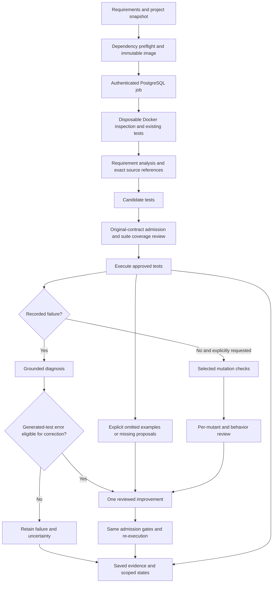

# Verification architecture and engineering choices

ReqTest checks focused Python or Node.js projects against original requirement
contracts. GenAI interprets natural-language behaviors, proposes assertions and
explains failures. Deterministic code validates identities, citations, admission,
execution records and budget boundaries. Neither a model approval nor a passing
test is an independent correctness oracle.

The diagram abbreviates the control flow. An explicitly rejected proposal can
also use the one improvement; an unchanged generated failure classified as a
potential implementation defect cannot authorize replacement. A single global
improvement budget prevents repeated optimization against the same implementation.

## Depth and stopping policy

Policy v13 defaults to requirement checks with no request-count limit. Users may set any positive request limit; the benchmark manifests keep explicit budgets.
Original-contract admission, suite coverage review, failure diagnosis and eligible
bounded improvement remain active. Optional mutation checks assess additional test
strength; they are offered explicitly so the user can choose the additional
resource and assurance scope. No efficiency or model-quality gain is established
for this revised policy. Old-version experiment records were removed at the
user's request; they are not current validation.

With mutation checks disabled, passing cases remain Partially Verified. Strict CI
still requires Verified; an explicitly configured non-strict CI gate can accept
supported partial checks. Requesting mutation checks does not ensure a complete
measurement or independent semantic correctness. Timeouts, unresolved survivors,
missing reviews, contradictions and failed assertions remain visible.

An optional request limit is enforced before provider dispatch, across all stages and worker retries. A reservation is saved before
calling the provider; failed and interrupted attempts consume slots. Cache hits
consume none. Interrupted requests can have unknown usage, so recorded tokens
are a known subtotal, not a complete bill. Token or currency ceilings are not
claimed. Model responses have a configurable 300-second default deadline per request; 0 disables that deadline while owner cancellation remains active. Output tokens and specification size have no fixed application cap. The durable queue expires jobs after 24 hours, and individual sandbox tools retain their own execution limits. Budget exhaustion produces an incomplete run, never verification.

## Context, state and execution

Large specifications use batches of five requirements and six behaviors, with up to four concurrent model calls after the first cache-warming request. Python runs can use a server subdirectory while retaining frontend source context. Browser checks use sandbox Chromium against the project's ASGI/WSGI application; failed checks retain screenshots. Frontend JavaScript is not mutation-tested.

- MiniSearch ranks local Markdown/text documentation. Initial analysis still sees
  the supported project context; this is not evidence of scalable semantic RAG.
- Follow-up review and diagnosis retain all original requirements and supporting
  requirement context, while selecting mapped full files. Unseen dependencies are
  not treated as validated. Exact citations establish provenance, not entailment.
- PostgreSQL stores private reports and checkpoints. Recovery checks source and
  Agent code identities, reuses completed work and retains consumed requests.
  A response interrupted before its checkpoint can require another budgeted call.
- Implementation snapshots and approved tests mount read-only into constrained
  disposable Docker execution. Source integrity is checked separately from test
  outcomes. Registry dependency preparation is a separate operation.
- Saved-test replay makes no model calls and retains the original review history
  and unresolved assurance. It cannot promote partial checks by avoiding analysis.

## Reproducible boundaries

`lib/python-agent.ts` owns orchestration; `lib/verification-policy.ts` owns policy
validation and request reservation; `lib/run-queue.ts` owns durable execution;
`lib/python-tools.ts` and `sandbox/` own isolated tools. `lib/run-evaluation.ts`
summarizes recorded evidence. `scripts/evaluate.ts` records frozen model runs;
`scripts/evaluate-decisions.ts` evaluates raw component decisions separately.

The current default model is the configured provider alias with low reasoning
effort, structured output and no automatic retries. No model-selection study has
established that it is optimal. A different model, prompt or runtime needs a new
frozen evaluation. Current model judgments still need independent human review. Retained v12 experiments identify older code snapshots; their results do not validate the current v13 implementation.
