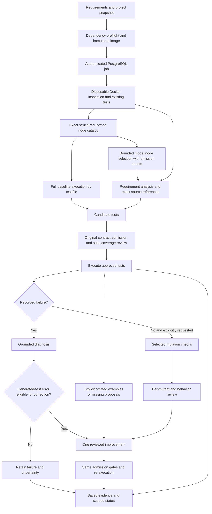

# Verification architecture and engineering choices

ReqTest checks focused Python or Node.js projects against original requirement
contracts. GenAI interprets natural-language behaviors, proposes assertions and
explains failures. Deterministic code validates identities, citations, admission,
execution records and budget boundaries. Neither a model approval nor a passing
test is an independent correctness oracle.

The diagram abbreviates the control flow. An explicitly rejected proposal can
also use the one improvement; an unchanged generated failure classified as a
potential implementation defect cannot authorize replacement. A single global
improvement budget prevents repeated optimization against the same implementation.

## Depth and stopping policy

Policy v16 defaults to requirement checks with no request-count limit. Users may set any positive request limit; the benchmark manifests keep explicit budgets.
Original-contract admission, suite coverage review, failure diagnosis and eligible
bounded improvement remain active. Optional mutation checks assess additional test
strength; they are offered explicitly so the user can choose the additional
resource and assurance scope. No efficiency or model-quality gain is established
for this revised policy. Old-version experiment records were removed at the
user's request; they are not current validation.

With mutation checks disabled, passing cases remain Partially Verified. Strict CI
still requires Verified; an explicitly configured non-strict CI gate can accept
supported partial checks. Requesting mutation checks does not ensure a complete
measurement or independent semantic correctness. Timeouts, unresolved survivors,
missing reviews, contradictions and failed assertions remain visible.

An optional request limit is enforced before provider dispatch, across all stages and worker retries. A reservation is saved before
calling the provider; failed and interrupted attempts consume slots. Cache hits
consume none. Interrupted requests can have unknown usage, so recorded tokens
are a known subtotal, not a complete bill. Token or currency ceilings are not
claimed. Model responses have a configurable 300-second default deadline per request; 0 disables that deadline while owner cancellation remains active. Output tokens and specification size have no fixed application cap. The durable queue expires jobs after 24 hours, and individual sandbox tools retain their own execution limits. Budget exhaustion produces an incomplete run, never verification.

## Context, state and execution

Large specifications use batches of five requirements and six behaviors, with up to four concurrent model calls after the first cache-warming request. Python runs can use a server subdirectory while retaining frontend source context. Browser checks use sandbox Chromium against the project's ASGI/WSGI application; failed checks retain screenshots. Frontend JavaScript is not mutation-tested.

- MiniSearch ranks local Markdown/text documentation. Large projects rank whole files by requirement/path terms, prioritizing mapped files during follow-up. A recorded 180,000-byte source budget replaces whole-project rejection. Oversized/omitted files retain names and hashes and are not inspected. This lexical selection is not evidence of scalable semantic RAG.
- Follow-up review and diagnosis retain all original requirements and supporting
  requirement context, while selecting mapped full files. Unseen dependencies are
  not treated as validated. Exact citations establish provenance, not entailment.
- PostgreSQL stores private reports and checkpoints. Recovery checks source and
  Agent code identities, reuses completed work and retains consumed requests.
  A response interrupted before its checkpoint can require another budgeted call.
- Implementation snapshots and approved tests mount read-only into constrained
  disposable Docker execution. Source integrity is checked separately from test
  outcomes. Registry dependency preparation is a separate operation.
- Saved-test replay makes no model calls and retains the original review history
  and unresolved assurance. It cannot promote partial checks by avoiding analysis.

## Reproducible boundaries

`lib/python-agent.ts` owns orchestration; `lib/verification-policy.ts` owns policy
validation and request reservation; `lib/run-queue.ts` owns durable execution;
`lib/python-tools.ts` and `sandbox/` own isolated tools. `lib/run-evaluation.ts`
summarizes recorded evidence. `scripts/evaluate.ts` records frozen model runs;
`scripts/evaluate-decisions.ts` evaluates raw component decisions separately.

The current default model is the configured provider alias with low reasoning
effort, structured output and no automatic retries. No model-selection study has
established that it is optimal. A different model, prompt or runtime needs a new
frozen evaluation. Current model judgments still need independent review. Superseded result exports were deleted; current frozen observations are indexed in experiments/README.md.

## Controlled diagnosis ablation

The experimental runner can prepare B1 candidates, then freeze one shared B3
analysis, admission review and initial execution before diagnosis. B2 and B3 reuse
that exact preparation and source; only diagnosis and its downstream repair
decision differ. Order alternates across repeats and both arms have the same
follow-up request ceiling. Paired totals include the B1 prefix and preparation
for each strategy; actual provider billing counts shared work once overall.
This mode is CLI-only and never relaxes production admission rules.

Every model request records serialized context/source bytes and provider usage
when available. Context selection retains whole files and original line numbers,
all original requirements and shared requirement context. A mapped source file
that was never inspected cannot support strict Verified credit.

## Defined cases and local dependency context (v15)

For a behavior marked incomplete, admission requires a supported review plus
`definedScope` containing a verbatim original-contract excerpt, finite inputs and
a reason the assertions need no missing contract detail. Absent or invented scope
fails closed. Ambiguous/not_testable behaviors remain blocked. Approved scoped
cases may execute and diagnose failures; the incomplete issue stays unchanged and
prevents strict Verified status. This separate-call model review is not semantic
proof or independent validation.

Focused context follows static Python local imports, package initializers and
relative JS/TS imports/re-exports transitively. Explicit mappings reserve space
first; whole dependency files then consume the same source budget. Cycles terminate.

## Complete Python execution with bounded model context (v16)

A pytest collection hook writes exact node IDs independently of the bounded
console log. Catalogs are capped explicitly at 50,000 nodes / 8 MB; exceeding
either bound marks collection incomplete. Full imported baselines execute by
test file to avoid operating-system argument limits. JUnit outcomes resolve to
the structured catalog, including class names and parameter values containing
quotes or `::`. Transport evidence has a 32 MB bound; an overflow fails explicitly.

The model receives a separate, file-balanced selection of up to 200 nodes / 24 KB.
Its prompts and saved provenance state how many nodes were omitted. Measurement
summaries retain global status counts, selected relevant outcomes and failure
records; the original full outcomes remain saved. This context selection never
reduces the execution baseline. At most 40 failures per phase are submitted for
model diagnosis, prioritizing generated artifacts; additional failures retain
explicit Uncertain decisions and cannot authorize repair.

Opaque assets in supported test/data/static directories are saved as original
bytes, capped at 500 KB each within the 3 MB expanded snapshot. Their sizes and
SHA-256 values participate in fingerprints and appear in provenance, without
decoding bytes into model source. Text-only legacy fingerprints stay unchanged.
Imports still exclude hidden paths and unsupported executable/archive assets.

Known installed pytest-timeout / pytest-xprocess plugins are explicitly enabled;
arbitrary global plugin autoload remains disabled. Pytest caches live in `/tmp`,
so xprocess does not invalidate source integrity. Active source/dependency paths
are available to Python subprocesses even when a fixture replaces PYTHONPATH.
Explicit static `pyproject.toml` name/version declarations supply distribution
metadata only; no package build hook runs and dynamic metadata is not invented.

Evaluation renders at most 100 outcome rows per page. Raw exports preserve full
execution evidence. Node.js still requires unique top-level node:test cases and
has its separately disclosed 200-node supported scope; Python scalability does
not imply support for arbitrary Node frameworks.

Execution diagnoses now select an `E...` reference to an unchanged line from the
actual saved outcome/log. The provider schema enumerates IDs; the server restores
the exact original text before normal evidence validation. Up to 300 unique
nonblank lines / 60 KB are indexed, prioritizing generated failure traces;
omissions are recorded. Unknown references fail validation. This prevents copied
indentation or invented traceback fragments from masquerading as exact quotes.
A real log line still does not establish semantic correctness of a diagnosis.
Legacy sandbox catalogs without explicit completeness remain marked incomplete.
Known omitted dependencies retain hashes and dependency links. Any uninspected
recorded transitive dependency prevents strict Verified credit, including when
reading older saved state assessments; this read-time check does not rewrite them. Resolution is a
conservative static candidate graph: dynamic imports, aliases, generated modules,
external packages and runtime configuration remain outside its guarantees. No
project code is evaluated to build this graph.
