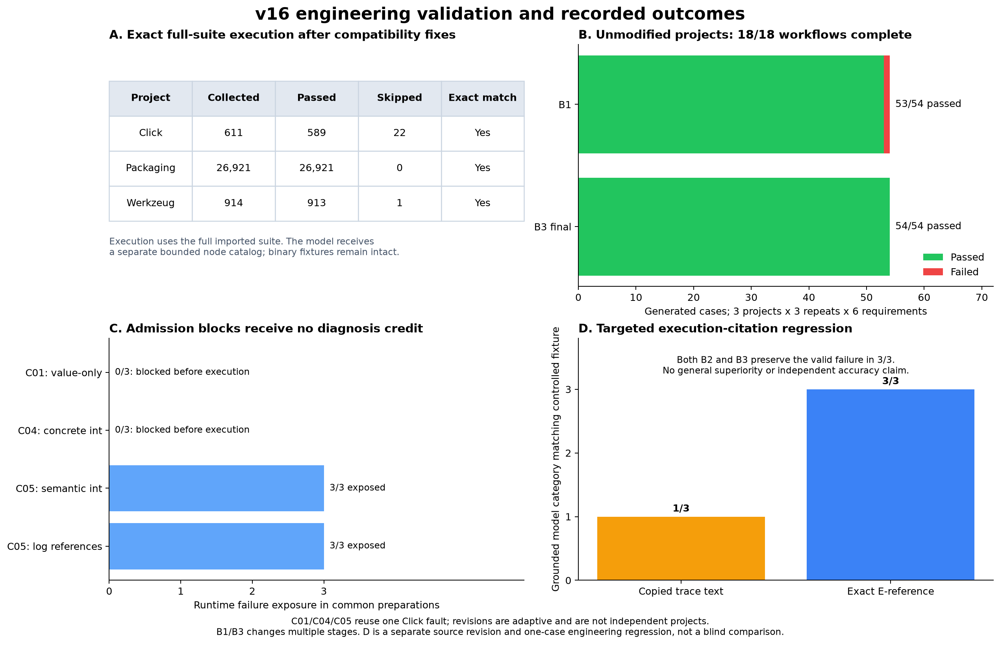

# v16 implementation, complete-runtime studies and regression evidence

Recorded on 2026-10-29 (Australia/Sydney), using gpt-6-luna. This is a technical
evidence inventory, not the academic report. Three pinned upstream projects are
reused across development studies; repeated observations and adaptive revisions
are not independent unseen projects. No independent human labels are claimed.



## Implemented changes

- Preserve supported fixture bytes with SHA-256/size records and include them in
  source integrity checks. Keep opaque assets out of model text. Legacy text-only
  source fingerprints remain compatible.
- Replace console-log node scraping with exact structured Python collection.
  Execute complete imported baselines by file; use an independently bounded model
  node catalog. Save all exact outcomes and render 100 rows per page.
- Enable installed pytest-timeout / pytest-xprocess plugins explicitly. Keep cache
  artifacts outside source; expose active paths and static declared name/version
  metadata to subprocesses without running project build hooks.
- Bound generation, diagnosis and repair views of large measurements while saving
  complete original outcomes. Source/log omission counts remain visible.
- Restore exact parameterized test IDs and source/requirement references from
  provider-safe IDs. Final execution diagnoses select `E...` log-line references,
  restored to unchanged raw text before evidence validation. Invented references
  fail closed. Legacy catalog completeness is not inferred from exit code alone.

## Exact full-suite compatibility

| Upstream runtime | Runtime .py files / physical lines | Full collected / executed nodes | Passed | Skipped | Failed / errors |
| --- | ---: | ---: | ---: | ---: | ---: |
| Click 8.1.7 | 16 / 10,124 | 611 | 589 | 22 | 0 / 0 |
| Packaging 24.2 | 16 / 5,653 | 26,921 | 26,921 | 0 | 0 / 0 |
| Werkzeug 3.0.6 | 52 / 20,672 | 914 | 913 | 1 | 0 / 0 |

[Full-suite preflight](preflight-summary.json) records exact set equality between
collected and executed IDs, intact source fingerprints, preserved asset hashes,
plugin behavior and exclusions. Full raw inspection/baseline evidence is in
`preflight-evidence.zip`, with uncompressed checksums. Python catalogs have an
explicit 50,000-node / 8 MB bound, not unlimited support. The separate model view
is capped at 200 nodes / 24 KB; it never selects the execution baseline.

## Recorded studies and source revisions

| Study | Completed / planned workflows | Common preparations | Source revision |
| --- | ---: | ---: | --- |
| [Unmodified projects](full-projects/metrics.json) | 18/18 | 0 | A: `20b6e20ddad7…` |
| [Stopped repair-context attempt](stopped-context-study/metrics.json) | 11/27 | 5 | A |
| [Controlled admission/recovery ablation](diagnosis-ablation/metrics.json) | 27/27 | 9 | B: `aeb2aff978bf…` |
| [C04 concrete-type revision](typed-valid-failure/metrics.json) | 9/9 | 3 | B |
| [C05 semantic-type revision](semantic-valid-failure/metrics.json) | 9/9 | 3 | B |
| [Exact execution-reference regression](execution-reference-regression/metrics.json) | 9/9 | 3 | C: `718e3dab55c3…` |

The five completed studies contain **72 workflow rows and 18 common
preparations**. The stopped attempt is separate: 14 recorded workflows include
11 completed, two context-window errors and one cancellation; 13 planned rows
are missing. It retains its five preparations. No failed result was replaced.
The three source revisions are not pooled as observations of one unchanged agent.

Revision A established complete-suite execution but still passed a full measured
result to the repair prompt. The stopped attempt exposed a 7,136,141-byte repair
context and actual provider errors. Revision B uses a bounded measurement view;
a real Docker regression saves 500 baseline outcomes and both 501-outcome
executions while limiting model repair evidence to at most 200 outcomes.
Revision C adds exact execution-line encoding after observed citation failures.
All histories retain their own source snapshots and input/model/image identities.

## What the experiments establish

The unmodified study uses six public API requirements per project and three
shared B1/B3 repeats. B1 generated **53 passing and one failing case** across
54 artifacts; B3's final suites recorded **54 passing cases**. The sole natural
failure was in Click: a generated test invoked both accepted endpoints before
asserting that the callback list held only the first result. B3 diagnosed this
execution-order error, repaired the test and passed a separate replay on unchanged
upstream code. The [exact derived trace](natural-generated-error.json) links both
raw reports, original/revised code, log evidence and the six-pass source-copy
replay. This is one observed natural error, not a population accuracy estimate.

The 27-row challenge study injects one Click boundary source fault, one Packaging
test assertion error and one Werkzeug test import error. Its common preparations
block all original candidates; these are admission observations, **not successful
runtime diagnosis**. B2/B3 each recover all three Packaging and all three Werkzeug
candidates to passing generated checks. Click's value-only candidate omits an
integer-type witness and has one repeat with no final approved artifact; its
completion status does not mean successful requirement verification.

C04 adds `type(value) is int`, which is itself stronger than the unchanged
integer contract. All three initial candidates are blocked. Subsequent generated
checks still detect the injected fault. This is an adaptive development revision,
not an independent project or a valid runtime-diagnosis sample.

C05 instead uses semantic integer checks with boolean exclusion. All three common
preparations admit and expose the source fault. Both B2 and B3 preserve detection
in 3/3. Before execution-reference encoding, B3 proposes the fixture category in
all three but only **1/3** decisions pass evidence validation: two copied log
fragments are not exact substrings and remain Uncertain. After encoding, a separate
same-case regression records **3/3** grounded category matches and unchanged
original artifacts in 3/3. [Before](semantic-valid-failure/diagnosis-exposure.json)
and [after](execution-reference-regression/diagnosis-exposure.json) retain all rows.
This targets citation reliability; it does not demonstrate general diagnostic
accuracy, independent semantic review or overall B3 superiority.

No admission rule was bypassed and no B3 win was required. Mutation checks were
disabled; recorded passing cases retain partial assurance. The full imported
baseline, six generated cases, workflow completion and strict requirement
verification are different quantities.

## Resources, validation and reuse

[Summary JSON](summary.json) contains every recorded workflow, missing-row counts,
actual resources, context sizes, baseline counts and saved behavior states.
There were **173 actual model requests**, including three errors/interruption
records with unavailable usage. The known token subtotal is **12,376,196**;
the complete token total and monetary bill remain unavailable. Shared preparation
requests are counted once in actual usage, not once per comparison arm.

Validation records include **197 passing tests, two optional skips and zero
failures** (199 total), TypeScript, lint, production build, exact execution-reference
SDK tests, binary/tamper checks and the repair-context regression's before/after
results. Five intercepted-API UI checks cover 26,927 saved outcomes, both pagination
controls and 320/390/768 px widths; these are UI checks, not new model observations.

Each study's `evidence.zip` preserves byte-identical raw files under their original
logical paths, verified against `evidence-files.sha256.json`. Original private
run directories remain untouched. To reanalyse a historical archive:

```sh
unzip experiments/results/v16-current/full-projects/evidence.zip -d /tmp/reqtest-replay
npm run experiment:analyze -- /tmp/reqtest-replay/index.json /tmp/reqtest-analysis
```

The archive includes its original Agent snapshot and manifest. Using current code
to make new model calls does not deterministically reproduce old source revisions,
API time/cache state or model responses. [Current reproduction commands](../../../examples/real-projects-v16/README.md),
fixed requirements/candidates/oracles and renderer copies are supplied. The final
SHA-256 inventory seals the exported bytes, figures and validation records.
