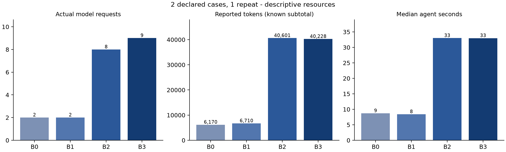

# v22 supplementary synthetic fault cases

Frozen commit `bd12d236fe65009ba02655f48556b0b397e3f575`, policy `contract-witness-v22-bounded-mutation-review`. Observed 2026-11-02 in Australia/Sydney; raw timestamps are UTC.

Two existing synthetic fixtures, four independent configurations, one repeat: eight planned workflows. Booking contains a known equality-boundary defect. Inventory contains a known equal-stock defect plus an existing test/requirement conflict and an underspecified notification rule. No initial generated tests are seeded. These are developer/AI-assisted development cases, not new upstream repositories, natural-error frequency or independently reviewed semantic labels.

Every declared attempt is retained, including failures, timeouts and unavailable references. The manifest was run once without automatic retry, candidate replacement or policy changes. `completed_with_limits` describes bounded workflow execution, not full requirement verification.

| Configuration | Completed / planned | Failed / missing | Review-limited runs | Generated pass / fail / error | Requests | Known tokens | Median agent seconds |
| --- | --- | --- | ---: | --- | ---: | ---: | ---: |
| B0 | 2/2 | 0/0 | 0 | 6/2/0 | 2 | 6,170 | 8.711 |
| B1 | 2/2 | 0/0 | 0 | 6/2/0 | 2 | 6,710 | 8.405 |
| B2 | 2/2 | 0/0 | 0 | 11/2/0 | 8 | 40,601 | 32.993 |
| B3 | 2/2 | 0/0 | 0 | 8/2/0 | 9 | 40,228 | 32.980 |

Actual resources: **21 requests / 93,709 known tokens**, with **0 requests of unknown usage**. Known usage is a subtotal whenever usage is missing; no monetary cost estimate is inferred. Latency includes failed agent attempts and excludes separate external reference probes.

B0/B1 artifact eligibility is not full-agent semantic admission. More generated or passing tests do not establish more verified requirements. Unreviewed relevance, incomplete mutation execution and unavailable differences remain unresolved. A model-grounded diagnosis is still an unreviewed model judgment.

| Case | Configuration | Original fault detected before / after | Reference replay usable | Generated failures |
| --- | --- | --- | --- | ---: |
| booking-boundary-fault | B0 | Yes / Yes | Yes | 1 |
| booking-boundary-fault | B1 | Yes / Yes | Yes | 1 |
| booking-boundary-fault | B2 | Yes / Yes | Yes | 1 |
| booking-boundary-fault | B3 | Yes / Yes | Yes | 1 |
| inventory-contract-fault | B0 | Yes / Yes | Yes | 1 |
| inventory-contract-fault | B1 | Yes / Yes | Yes | 1 |
| inventory-contract-fault | B2 | Yes / Yes | Yes | 1 |
| inventory-contract-fault | B3 | Yes / Yes | Yes | 1 |

Detection requires a generated assertion failing on the original faulty source and passing on a separately corrected copy validated by the external witness. Original code remains unchanged. Reference disagreements are not independently established false-positive precision. Detection and preservation do not by themselves establish diagnosis accuracy or superior causal effects from diagnosis.

`workflow-details.json` retains admission corrections, initial approved runtime failures, diagnoses, states and review limits. Correcting an admission-rejected artifact is not admitted-runtime error repair. Zero qualifying runtime-error opportunities leave repair effectiveness unavailable. Independent semantic accuracy, diagnosis F1 and reviewed mutation strength are not inferred.

`identity.json`, standard JSON/CSV, the original runner log and `evidence.zip` preserve the frozen inputs, Agent snapshot, every report/request record, external references and post-run source checks. All imported sources were checked against their original reference fingerprints. Unzip the archive and run `npm run experiment:analyze -- PATH/index.json OUTPUT` to inspect saved evidence with zero model calls.

This is an internal development comparison, not a held-out benchmark or comparison with external commercial coding products. Independently generated full workflows bundle several differences, so this design does not isolate diagnosis alone. Inspect failures and trade-offs before making a B3 advantage claim.

The resource figure does not encode correctness or independently reviewed test adequacy. Missing usage, if any, remains unavailable in the underlying metrics.

Regenerate the resource figures offline with `python3 experiments/render-v22-resources.py` in an environment with Matplotlib installed. The renderer reads saved measurements and makes no model calls.
