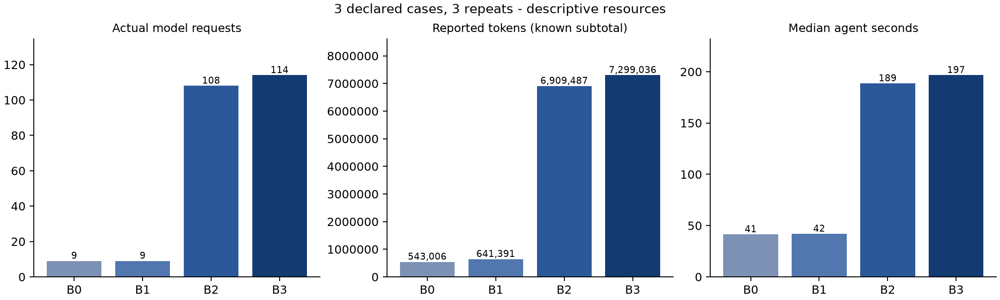

# v22 repeated real-project matrix

Frozen commit `bd12d236fe65009ba02655f48556b0b397e3f575`, policy `contract-witness-v22-bounded-mutation-review`. Observed 2026-11-02 in Australia/Sydney; raw timestamps are UTC.

Three pinned upstream projects (Click 8.1.7, Packaging 24.2, Werkzeug 3.0.6), four independent configurations and three repeats: 36 planned workflows. Six developer/AI-assisted contracts per project, with fixed executable witnesses and no injected implementation faults. The smoke is not pooled with these repeats. Repeats share projects; they are not nine independent projects per configuration.

Every declared attempt is retained, including failures, timeouts and unavailable references. The manifest was run once without automatic retry, candidate replacement or policy changes. `completed_with_limits` describes bounded workflow execution, not full requirement verification.

| Configuration | Completed / planned | Failed / missing | Review-limited runs | Generated pass / fail / error | Requests | Known tokens | Median agent seconds |
| --- | --- | --- | ---: | --- | ---: | ---: | ---: |
| B0 | 9/9 | 0/0 | 0 | 54/0/0 | 9 | 543,006 | 41.374 |
| B1 | 9/9 | 0/0 | 0 | 54/0/0 | 9 | 641,391 | 41.922 |
| B2 | 9/9 | 0/0 | 6 | 138/0/0 | 108 | 6,909,487 | 188.542 |
| B3 | 9/9 | 0/0 | 6 | 151/0/0 | 114 | 7,299,036 | 196.583 |

Actual resources: **240 requests / 15,392,920 known tokens**, with **0 requests of unknown usage**. Known usage is a subtotal whenever usage is missing; no monetary cost estimate is inferred. Latency includes failed agent attempts and excludes separate external reference probes.

B0/B1 artifact eligibility is not full-agent semantic admission. More generated or passing tests do not establish more verified requirements. Unreviewed relevance, incomplete mutation execution and unavailable differences remain unresolved. A model-grounded diagnosis is still an unreviewed model judgment.

| Project | Configuration | Observed / planned suites | Distinct literal suite hashes |
| --- | --- | --- | ---: |
| click-full | B0 | 3/3 | 3 |
| click-full | B1 | 3/3 | 3 |
| click-full | B2 | 3/3 | 3 |
| click-full | B3 | 3/3 | 3 |
| packaging-full | B0 | 3/3 | 3 |
| packaging-full | B1 | 3/3 | 3 |
| packaging-full | B2 | 3/3 | 3 |
| packaging-full | B3 | 3/3 | 3 |
| werkzeug-full | B0 | 3/3 | 3 |
| werkzeug-full | B1 | 3/3 | 3 |
| werkzeug-full | B2 | 3/3 | 3 |
| werkzeug-full | B3 | 3/3 | 3 |

Suite hashes describe literal generated-output variation, not semantic correctness or population reliability. These projects have no declared injected fault, so comparative defect detection is unavailable here. Inspect final reference disagreements separately; a passing limited contract suite does not prove an upstream project bug-free.

`workflow-details.json` retains admission corrections, initial approved runtime failures, diagnoses, states and review limits. Correcting an admission-rejected artifact is not admitted-runtime error repair. Zero qualifying runtime-error opportunities leave repair effectiveness unavailable. Independent semantic accuracy, diagnosis F1 and reviewed mutation strength are not inferred.

`identity.json`, standard JSON/CSV, the original runner log and `evidence.zip` preserve the frozen inputs, Agent snapshot, every report/request record, external references and post-run source checks. All imported sources were checked against their original reference fingerprints. Unzip the archive and run `npm run experiment:analyze -- PATH/index.json OUTPUT` to inspect saved evidence with zero model calls.

This is an internal development comparison, not a held-out benchmark or comparison with external commercial coding products. Independently generated full workflows bundle several differences, so this design does not isolate diagnosis alone. Inspect failures and trade-offs before making a B3 advantage claim.

The resource figure does not encode correctness or independently reviewed test adequacy. Missing usage, if any, remains unavailable in the underlying metrics.

Regenerate the resource figures offline with `python3 experiments/render-v22-resources.py` in an environment with Matplotlib installed. The renderer reads saved measurements and makes no model calls.
